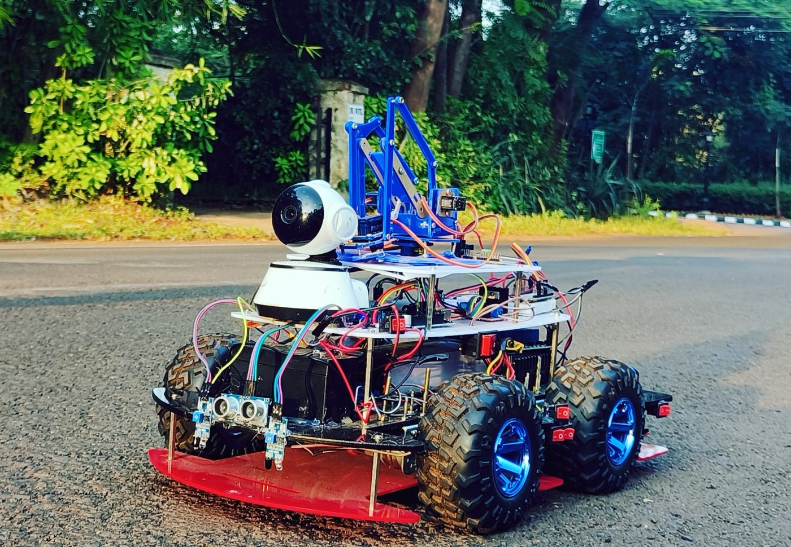
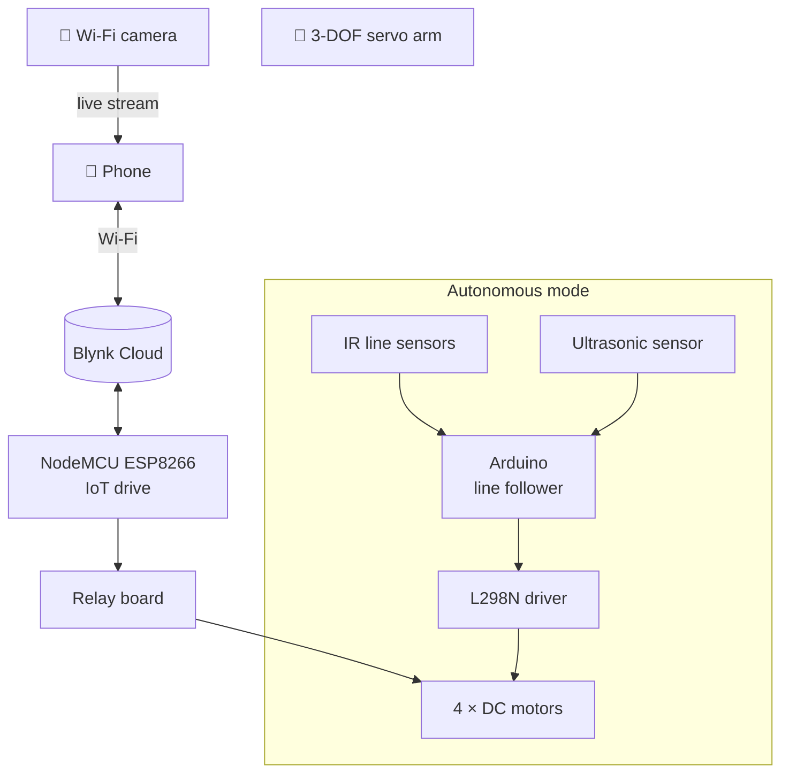
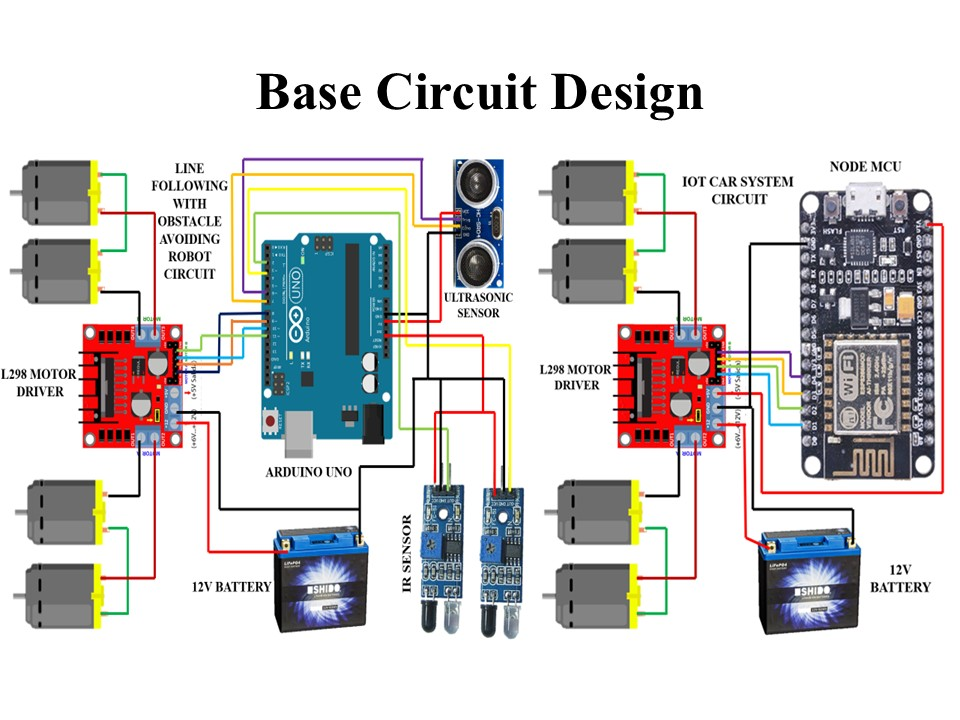
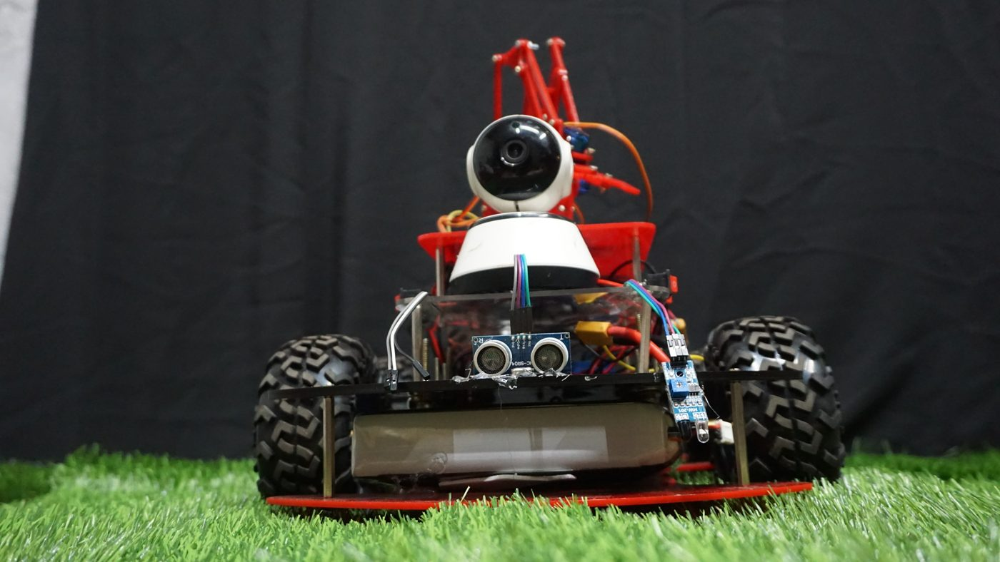
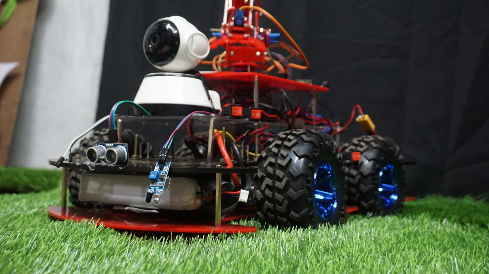
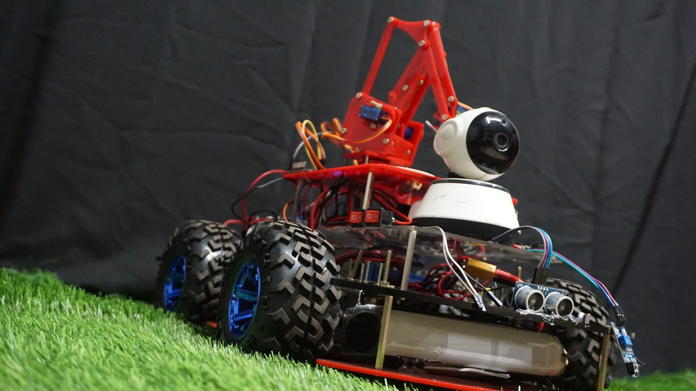
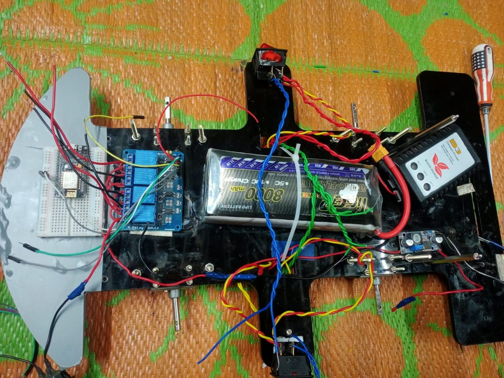

<div align="center">


### 🎥 A four-wheel patrol robot with a live camera eye and a robotic arm.


</div>

---

## 📌 At a glance

> A **semi-autonomous robot** that combines **surveillance, navigation and object handling** in one compact platform. Drive it from your phone, or switch it to **autonomous mode** and it follows a line on its own and stops for obstacles — while a **Wi-Fi camera** streams live video and a **3-DOF arm** picks up small objects.

<div align="center">
  
  <br/><sub><i>Four-wheel drive base, pan-tilt Wi-Fi camera and servo arm on a two-deck chassis</i></sub>
</div>

| 🗓️ Built | 💰 Funding | 🧠 My role | 🎮 Control |
|:---:|:---:|:---:|:---:|
| 2022 | Self-funded | Designed and built the whole robot | Phone app · autonomous line following |

---

## 📑 Contents

- [What it can do](#-what-it-can-do)
- [Two brains, two modes](#-two-brains-two-modes)
- [Hardware](#-hardware)
- [Circuit](#-circuit)
- [Code walkthrough](#-code-walkthrough)
- [Gallery](#-gallery)
- [Repository map](#-repository-map)
- [What I learned](#-what-i-learned)
- [Where it could go](#-where-it-could-go)

---

## ✨ What it can do

<table>
<tr>
<td width="33%" align="center" valign="top">

### 📱 IoT driving
Forward, back, left and right from a **Blynk dashboard** — from anywhere with internet.

</td>
<td width="33%" align="center" valign="top">

### 🧭 Self-driving
**IR sensors** follow a black line; an **ultrasonic sensor** stops the robot when something is in the way.

</td>
<td width="33%" align="center" valign="top">

### 🎥 Live video
A pan-tilt **Wi-Fi camera** streams to a phone for remote patrol and monitoring.

</td>
</tr>
<tr>
<td width="33%" align="center" valign="top">

### 🦾 Pick & place
A **3-DOF servo arm** — base, shoulder and gripper — lifts and moves small objects.

</td>
<td width="33%" align="center" valign="top">

### 🔋 Battery powered
12 V Li-ion pack with a buck-regulated 5 V rail for logic and servos.

</td>
<td width="33%" align="center" valign="top">

### 🛡️ Built for real use
Security patrols, warehouse checks or greenhouse monitoring.

</td>
</tr>
</table>

---

## 🧠 Two brains, two modes



- **IoT mode** — the NodeMCU receives commands from the app and switches four relays to drive the motor pairs.
- **Autonomous mode** — an Arduino reads two IR sensors and an ultrasonic sensor and drives the motors through an L298N driver.
- Only one mode drives the wheels at a time.

---

## 🔌 Hardware

| Subsystem | Components |
|---|---|
| 🧠 **Controllers** | NodeMCU (ESP8266) for IoT · Arduino for line following |
| 🏎️ **Drive** | 4 × DC geared motors · off-road wheels · relay board + L298N driver |
| 👁️ **Sensors** | 2 × IR line sensors · HC-SR04 ultrasonic |
| 🎥 **Vision** | Pan-tilt Wi-Fi camera with live streaming |
| 🦾 **Arm** | 3 servos (base · shoulder · gripper) on acrylic links |
| 🔋 **Power** | 12 V Li-ion · buck converter to 5 V · switches and fuses |
| 🏗️ **Chassis** | Two-deck acrylic plates — drive and battery below, camera and arm above |

---

## 🔌 Circuit

<div align="center">

<br/><sub><b>Left:</b> Arduino + IR + ultrasonic + L298N (autonomous) · <b>Right:</b> NodeMCU + driver (IoT)</sub>
</div>

---

## 💻 Code walkthrough

### 📱 [`IOT_CAR_TK_CODE.ino`](IOT_CAR_TK_CODE.ino) — IoT drive (NodeMCU)

```cpp
BLYNK_WRITE(V0) {                 // forward button
  int forward = param.asInt();
  digitalWrite(relay1, forward ? LOW : HIGH);   // left motors
  digitalWrite(relay3, forward ? LOW : HIGH);   // right motors
}
```

| Pin | Action | Relays |
|:---:|---|---|
| `V0` | ⬆️ Forward | 1 + 3 |
| `V1` | ⬇️ Back | 2 + 4 |
| `V2` | ➡️ Right | 1 + 4 |
| `V3` | ⬅️ Left | 2 + 3 |

### 🧭 [`LINE_FOLLOWING_WITH_OBSTACLE.ino`](LINE_FOLLOWING_WITH_OBSTACLE.ino) — autonomous mode (Arduino)

```cpp
int distance = pulseIn(10, HIGH) * 0.17;   // ultrasonic echo → mm
if (distance <= 100) stop_motor();          // obstacle within 10 cm
else {
  if (!R_S && !L_S) forward();
  if (!R_S &&  L_S) turnLeft();
  if ( R_S && !L_S) turnRight();
  if ( R_S &&  L_S) stop_motor();           // end of line
}
```

<details>
<summary><b>▶ How to run it</b></summary>

1. **IoT drive:** install the ESP8266 board package and Blynk library, add **your own** Blynk auth token and Wi-Fi details, upload to a NodeMCU, and add four buttons on `V0`–`V3`
2. **Line follower:** upload `LINE_FOLLOWING_WITH_OBSTACLE.ino` to an Arduino UNO; wire motors to pins 2–5, IR sensors to 6–7, ultrasonic Trig/Echo to 9/10
3. Lay a black tape track on a light floor and switch to autonomous mode

</details>

---

## 📸 Gallery

<table>
<tr>
<td width="50%"></td>
<td width="50%"></td>
</tr>
<tr>
<td align="center"><sub><b>Front</b> — camera, ultrasonic and IR sensors</sub></td>
<td align="center"><sub><b>Side</b> — sensor deck and arm</sub></td>
</tr>
<tr>
<td width="50%"></td>
<td width="50%"></td>
</tr>
<tr>
<td align="center"><sub><b>Arm side</b> — 3-DOF servo manipulator</sub></td>
<td align="center"><sub><b>Build</b> — wiring the electronics deck</sub></td>
</tr>
</table>

---

## 🗂️ Repository map

```
📦 Multifunction-Semi-Autonomous-Vehicle-
 ┣ 📜 IOT_CAR_TK_CODE.ino                 ← NodeMCU + Blynk four-wheel IoT drive
 ┣ 📜 LINE_FOLLOWING_WITH_OBSTACLE.ino    ← Arduino line follower with obstacle stop
 ┣ 🖼️ images-base-circuit.JPG             ← base circuit diagram
 ┣ 📂 media                               ← photos used in this README
 ┗ 📘 README.md
```

---

## 🧠 What I learned

- 🔀 **Splitting control across two microcontrollers** — one for connectivity, one for real-time sensing
- 🧭 **Sensor-based navigation** — reading IR and ultrasonic sensors and turning them into motor decisions
- 🦾 **Servo kinematics** for a small manipulator
- 🛠️ **Full-stack hardware** — chassis, wiring, power and firmware, all built and funded myself

---

## 🚀 Where it could go

- [ ] Obstacle **detour** and return to the line, instead of a full stop
- [ ] Merge both modes onto a single ESP32
- [ ] Camera-based object detection to guide the arm
- [ ] Mapping and navigation with ROS 2 *(I'm currently learning ROS 2)*

---

<div align="center">

### 👋 Built by **Ajay Arjun Mannolkar**
M.Sc. Mechatronics & Cyber-Physical Systems · THD Deggendorf

[](https://technolkar.github.io)
[](https://www.linkedin.com/in/ajaymannolkar)
[](https://www.youtube.com/@TechnolkarInnovations)

⭐ *If this robot gave you ideas, give the repo a star!*


</div>
